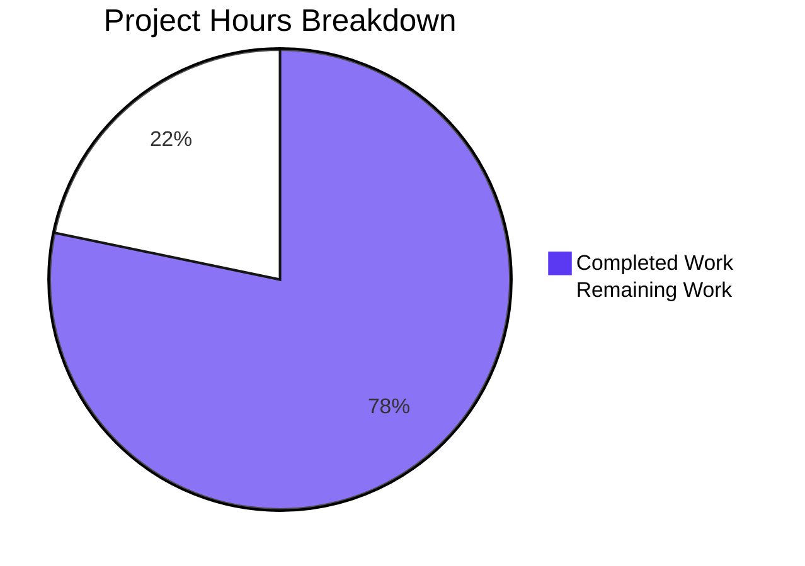

# 1. Executive Summary

## 1.1 Project Overview

This delivery is a literal artefact rather than an application: a static data file at the repository root holding `Welcome to Blitzy` as exactly 42,900 identical lines, a one-line Python program that prints that same string once, and a two-line `.gitattributes` declaration keeping the data file's 772,200 bytes identical on every checkout. No committed code produces those lines — the file is static data, and nothing in the repository regenerates it. A reviewer accepts the delivery with shell commands; anyone with Python 3 can run `python3 hello_world.py`.

## 1.2 Completion Status



**Completion: 78%** — 18 of 23 hours delivered (18 ÷ 23 = 78.3%). Completed work is Dark Blue (#5B39F3); remaining work is White (#FFFFFF).

| Metric | Hours |
|---|---|
| Total Hours | 23 |
| Completed Hours (Baseline: Human with agentic-assist) | 18 |
| Remaining Hours | 5 |

## 1.3 Key Accomplishments

- **Static data artefact** — `hello_world.txt` holds exactly 42,900 lines of `Welcome to Blitzy` in 772,200 bytes, SHA-256 `57ea77eb9a62076f138801a0436aec0a930b79c0c1220eb45e8539ba5c196d9c`.
- **Byte exactness** — no BOM, no carriage return, no blank or partial line, one trailing newline, every line exactly 17 characters.
- **One-line printer** — `hello_world.py` writes 18 bytes to stdout, exits 0 with empty stderr, and takes no input.
- **No producer in the repository** — no script, test, hook, CI step or entry point generates the lines.
- **Checkout stability** — `.gitattributes` makes a `core.autocrlf=true` clone reproduce the identical bytes; an emptied declaration diverges to 815,100 bytes, so the two-line file is load-bearing.
- **One acceptance gate** — the documented chain prints `ACCEPTED` in the checkout and in a fresh clone, and detects a CRLF conversion, a BOM, a dropped line, an added line and a missing final newline.
- **Zero operational footprint** — no dependency, manifest, build step, service, port, database, credential or configuration value.

## 1.4 Critical Unresolved Issues

Six of the 24 tracked requirements carry a residual condition; no requirement is unmet.

| Issue | Impact | Owner | ETA |
|---|---|---|---|
| No in-repository guard re-checks the delivered bytes (no test, hook or CI step by design) | Drift after delivery is invisible until the acceptance chain is re-run | Release owner | With first consumer integration |
| A Windows-host checkout has not been exercised; the guarantee is proven through POSIX clones that simulate `core.autocrlf` | The checkout guarantee's stated Windows scenario is unconfirmed on Windows | Release owner | Before the first Windows consumer |
| A recipient's own `.git/info/attributes` outranks the committed declaration and can force CRLF (815,100 bytes measured) | The guarantee holds for every ordinary configuration, not a deliberately overridden one | Repository owner | Accept, or enforce out of band |
| The 18-byte stdout contract is POSIX-only (console capture 19 bytes; an explicit non-UTF-8 stream encoding differs) | A byte comparison in a non-POSIX capture sees a false failure | Consumer integrator | Before automating capture |
| `hello_world.txt -text` makes the data file binary to Git: no `core.safecrlf` warning, no text diff or merge | A corrupted working copy can be committed without complaint and cannot be reviewed as a diff | Repository owner | Digest check before every commit touching it |
| The documented acceptance chain needs bash process substitution and fails under dash | A reviewer using `/bin/sh` sees a false failure | Release owner | 1 hour |

## 1.5 Access Issues

No access issues identified. The delivery calls no external system, holds no credential, binds no port and needs no permission beyond read access to its own checkout and a Python 3 interpreter.

## 1.6 Recommended Next Steps

1. **[High]** Run the acceptance gate on the merged tree and record the resulting digest, so the accepted state is pinned.
2. **[High]** Validate a Windows checkout under `core.autocrlf=true`: 772,200 bytes, zero carriage returns, the pinned digest, `lf` in index and worktree.
3. **[High]** Add a digest, length and count assertion where the artefact is consumed, since the repository deliberately ships none.
4. **[Medium]** Rewrite the acceptance chain without process substitution and confirm it passes under bash and dash.
5. **[Low]** Record the disposition of the `.git/info/attributes` residual: accept it as Git precedence, or enforce the digest out of band.

# 2. Project Hours Breakdown

## 2.1 Completed Work Detail

| Component | Hours | Description |
|---|---|---|
| Requirement interpretation and constraint resolution | 2 | Settled the six rows of the constraint register and their four tensions: "42.9K" is exactly 42,900; one file rather than two; minimality binds the source, not the data file; the printer prints once so it is not the forbidden generator. Traces to the user's five operative constraints. |
| Checkout declaration — `.gitattributes` | 3 | Chose the exempting `-text` form over `text eol=lf`, established attribute precedence, and verified index and worktree line endings for all four tracked paths. Traces to the checkout-stability requirement. |
| Data artefact — `hello_world.txt` | 3 | Materialised the 42,900-line file once from a single expression, then pinned its line count, byte size, distinct value, first and last byte and digest. Traces to the artefact-count and byte-exactness requirements. |
| Printer — `hello_world.py` | 3 | One-statement program, plus its whole runtime contract: stdout bytes, exit status, stderr silence, argument tolerance, environment and working-directory independence, idempotency, concurrency and error paths. Traces to the print requirement and source minimality. |
| Acceptance evidence and transport verification | 5 | The 18-row evidence table and the single acceptance chain, per-recipient clone variants (`core.autocrlf` true and input, `core.eol=crlf`, an environment config layer, a cloner attributes file, a linked worktree, `checkout-index`, `git archive`), and the emptied-declaration sensitivity control. Traces to the generation prohibition, the zero-dependency requirement and checkout stability. |
| Repository hygiene and delivery provenance | 2 | Foundation-first commit order, the three-path addition against the baseline, the absence sweeps for every excluded artefact family, and preservation of the pre-existing `README.md`. Traces to the repository-structure and stage-order requirements. |
| **Total** | **18** | |

## 2.2 Remaining Work Detail

| Category | Hours | Priority |
|---|---|---|
| Windows-recipient checkout validation of the line-ending pin (the checkout guarantee's Windows scenario) | 2 | High |
| Consumer-side byte guard for the delivered artefact, plus the recorded disposition of the `.git/info/attributes` residual | 2 | High |
| Shell-portable acceptance recipe and recorded POSIX capture conditions | 1 | Medium |
| **Total** | **5** | |

## 2.3 Hours Reconciliation

- Completed hours, summed from Section 2.1: 2 + 3 + 3 + 3 + 5 + 2 = **18**.
- Remaining hours, summed from Section 2.2: 2 + 2 + 1 = **5**.
- Total project hours: 18 + 5 = **23**.
- AAP-scoped completion: 18 ÷ 23 = 0.783 → **78%**, the figure carried in Sections 1.2, 7 and 8.

Every hour in 2.1 traces to a requirement of the plan for this delivery, and every hour in 2.2 to the path from the accepted artefact to its first real consumer. No remaining hour is AAP-scoped implementation work: all 24 tracked requirements are met.

# 3. Test Results

| Area / Category | Framework | Tests | Passed | Failed | Coverage | What This Proves |
|---|---|---|---|---|---|---|
| Data artefact byte and count invariants | Shell gate (GNU coreutils, `wc`/`sort`/`grep`/`awk`/`od`/`sha256sum`) | 10 | 10 | 0 | n/a — no instrumented coverage; the checks are byte measurements | The file is exactly 42,900 LF-terminated lines of one 17-byte value in 772,200 bytes, with no BOM, no carriage return, no blank line and no partial final line |
| Printer stdout and exit contract | Shell gate on CPython 3.13.18 | 13 | 13 | 0 | n/a — the program has no branch to cover | `python3 hello_world.py` writes 18 bytes to stdout, exits 0, writes nothing to stderr, and is invariant across arguments, environments, repeated runs and concurrent runs |
| Source minimality and statement identity | Shell gate (`wc`, `od`, `cmp`) | 3 | 3 | 0 | n/a | The program is one newline-terminated source line and byte-identical to the statement the delivery fixes |
| Checkout transport of the artefact | Git 2.56.1 + shell gate | 9 | 9 | 0 | n/a | A fresh clone under `core.autocrlf=true` reproduces 772,200 bytes, zero carriage returns, the pinned digest and `lf` in index and worktree — and the program and acceptance chain are green inside that clone |
| Declaration sensitivity control | Git + shell gate | 3 | 3 | 0 | n/a | With the declaration emptied, the same clone yields 815,100 bytes and 42,900 carriage returns, proving the two-directive file is what preserves the bytes |
| Repository absence and provenance | `find`, `grep`, `git ls-files -s`, `git diff --name-status` | 6 | 6 | 0 | n/a | No producer, manifest, build, test, CI or tooling path exists; the tracked set is the three delivered paths plus the pre-existing `README.md`; nothing was modified or deleted |
| End-to-end acceptance chain | Shell gate on bash 5.3.9, plus a portable form verified on dash | 2 | 2 | 0 | n/a | The documented gate prints `ACCEPTED` with exit 0 in the checkout and in a fresh clone |
| **Total** | — | **46** | **46** | **0** | — | — |

### Not Covered

- **No automated guard exists, by design.** The delivery ships no test suite, hook or CI step — the constraint forbids code that produces the lines, and a suite asserting the count would hold the number a second time. Every property above is asserted by commands a reviewer runs, so drift between runs is not detected by anything inside the repository.
- **A Windows-host checkout was not exercised.** The protection is proven through POSIX clones that simulate `core.autocrlf` (true, input, and with `core.eol=crlf`), and through a control that produces 815,100 bytes with 42,900 carriage returns when the declaration is emptied. No Windows machine took part, so a reviewer should confirm the byte count, the digest and `git ls-files --eol` on Windows before the artefact is consumed there.
- **A pseudo-terminal capture and an explicit non-UTF-8 stdout encoding were not exercised.** The 18-byte guarantee is a POSIX pipe-or-file guarantee; a terminal driver translates the newline to CR LF and an explicit `PYTHONIOENCODING` changes the byte count. A reviewer automating capture should compare bytes through a pipe or file.
- **No concurrent read-while-rewritten case exists to test.** The artefact is static, nothing in the repository writes it, and the program opens no file, so there is no path to exercise.
- **No browser, HTTP, database or queue surface exists**, so a UI, API or integration suite has nothing to address — the whole runtime surface of this delivery is one command and one file.

# 4. Runtime Validation & UI Verification

- ✅ **Printer start-up** — `python3 hello_world.py` from the repository root prints `Welcome to Blitzy`, writes exactly 18 bytes and exits 0 with empty stderr.
- ✅ **Printer invocation independence** — the same 18 bytes from a foreign working directory, under `env -i`, with `--help` and arbitrary arguments, with stdin closed, and under `LC_ALL=C` with `PYTHONIOENCODING=utf-8`.
- ✅ **Printer idempotency and concurrency** — three sequential runs are byte-identical (stdout SHA-256 `2dc7e85a734de043468d7beb8ee5294e0c04440f23fd89b69fd8ea0ee7971951`); four simultaneous runs produce 72 bytes with no interleaving.
- ✅ **Data artefact at rest** — 42,900 lines, 772,200 bytes, one distinct value, zero carriage returns, digest `57ea77eb9a62076f138801a0436aec0a930b79c0c1220eb45e8539ba5c196d9c`.
- ✅ **Checkout transport** — a fresh `core.autocrlf=true` clone reproduces the identical artefact with `lf` in index and worktree, and both the program and the acceptance chain are green inside that clone.
- ✅ **Declaration sensitivity** — with the two directives emptied in a copy, the same clone yields 815,100 bytes, 42,900 carriage returns and a failing chain, so the declaration is load-bearing.
- ✅ **End-to-end acceptance** — the documented gate prints `ACCEPTED` with exit 0; its portable form also passes under both bash and dash.
- ⚠ **Printer error paths** — a full or immediately closed stdout exits 120 with `OSError: [Errno 28]` or `BrokenPipeError: [Errno 32]` on stderr and never a success-shaped output; no requirement governs the case and any handler would cost a source line.
- ✅ **Failures** — none observed across the flows above.
- **Never exercised at runtime:** a Windows-host checkout (only POSIX clones simulating `core.autocrlf`), a pseudo-terminal capture, an explicit non-UTF-8 stdout encoding, and any interpreter other than CPython 3.13.18. Nothing else delivered went unexercised.

There is no UI, browser, HTTP endpoint, database or queue in this delivery: the whole runtime surface is one command and one static file, so no screen, route or integration could be driven.

# 5. Compliance & Quality Review

## 5.1 Compliance Matrix

| Deliverable | Benchmark | Status | Progress |
|---|---|---|---|
| Literal printed unformatted | Functional correctness | ✅ PASS | 100% |
| Fewest source lines, standard library only | Source minimality | ✅ PASS | 100% |
| 42,900 duplicate lines in one named file | Count correctness | ✅ PASS | 100% |
| No committed producer of the lines | Provenance / generation prohibition | ✅ PASS | 100% |
| Data artefact bytes (17-byte lines, LF only, no BOM, 772,200 bytes) | Data integrity | ✅ PASS | 100% |
| Printer stdout, exit status and silence | Runtime behaviour | ✅ PASS | 100% |
| Checkout declaration and its measured effect | Repository configuration | ✅ PASS | 100% |
| Absence of excluded artefact families (build, test, CI, docs, UI, tooling) | Scope discipline | ✅ PASS | 100% |
| Dependency and supply-chain surface (none) | Security baseline | ✅ PASS | 100% |
| Secrets and personal data (none present, none read) | Security baseline | ✅ PASS | 100% |
| Input, injection and privilege surface (none exists) | Security baseline | ✅ PASS | 100% |
| Acceptance evidence and definition of done | Verification completeness | ✅ PASS | 100% |

## 5.2 AAP & Rule Divergences and Gaps

No user-specified rules were provided for this delivery, so no rule divergence is possible and none is claimed. The rows below are every departure from the plan's own text, plus the conditions the delivered result accepts rather than closes.

| # | What the AAP/Rule Required | What Was Delivered Instead | Why It Diverged | Impact | Remediation |
|---|---|---|---|---|---|
| D1 | The quality-standard prose describes the program as "a 24-character line" with "a single space inside the call parentheses" | `hello_world.py:1` is 26 characters / 27 bytes, `print("Welcome to Blitzy")`, with no space inside the parentheses | The same plan fixes the exact statement content in its minimal-code section and states that is the only place it is written out; a 24-character spelling cannot emit this literal, so the descriptive count cannot govern | None on delivered bytes; a reader trusting the prose would misread the file | None needed — correct the prose if the plan text is reused |
| D2 | The product-understanding section states the checkout "is not under version control, so nothing there is tracked today", and the tracked-path check names three paths | The work was applied to an existing repository whose baseline commit `1d92523` already tracked `README.md`; the tracked set is those three paths plus it, and `README.md` is byte-unchanged | **Sanctioned** — the repository already existed and `README.md` had to stay; the tracked-path check therefore reads as the three delivered paths in addition to that pre-existing file | `git ls-files` returns four paths, so a literal reading of the check looks like a failure | None — read the check as three deliveries plus the pre-existing file |
| D3 | The token-economy requirement states the 42,900 lines never passed through a model and were materialised once by a command stored in no repository file | The tree holds the static committed blob, and no producer or repetition idiom appears in any tracked file; how the bytes were produced leaves no trace in a commit | The requirement describes a process rather than a stored property, and the tree-observable half of it holds | A consumer must re-verify bytes rather than rely on provenance | Pin the digest, count and byte size into any later verification step |
| D4 | The plan records CPython 3.12.3 and a host where the `file` utility is absent | Measured and verified on CPython 3.13.18, with the content class asserted from bytes; `file` is present but unused | The plan was written against a different environment snapshot | None — `print` semantics are stable across Python 3 and no check depends on `file` | None needed |
| D5 | The acceptance evidence assumes the byte contract is re-checkable | Nothing inside the repository re-checks the artefact: no test, hook or CI step exists | The constraint forbids code that produces the lines, and the plan's exclusions forbid a test suite, pipeline and normaliser — the properties are asserted by commands a reviewer runs | Post-delivery drift is undetected until the chain is re-run | Add a digest, length and count assertion where the artefact is consumed (2 h) |
| D6 | The line-ending declaration must keep the bytes stable, with the byte evidence as the guard of record | `hello_world.txt -text` makes the path binary to Git: no `core.safecrlf` warning and no text diff or merge on it | The exempting form is the only directive that prevents conversion in both directions, and it was fixed as the mechanism | A corrupted working copy commits without complaint and cannot be reviewed as a diff | Compare the digest rather than the diff before any commit touching the file (covered by D5's guard) |
| D7 | "Every clone and checkout yields the identical 772200 bytes" | Every ordinary recipient configuration reproduces the bytes; a recipient who writes `hello_world.txt text eol=crlf` into their own `.git/info/attributes` and re-checks out gets 815,100 bytes | Git resolves the per-repository info layer above every committed attribute file by design, and every defence (filter, hook, CI) is excluded | The guarantee is a property of ordinary clones, not of a deliberately overridden one | Accept and record, or enforce the digest out of band (2 h) |
| D8 | The program's contract is 18 bytes on stdout and exit 0 | True on a POSIX pipe or file; a console capture yields 19 bytes and an explicit non-UTF-8 stream encoding changes the count | CPython's text layer translates the newline per stream, and adding stream handling would cost a source line against the minimality constraint | Byte comparison must run on a POSIX pipe or file with no encoding override | None — record the capture conditions |
| D9 | The documented one-command acceptance gate is the reviewer's procedure | The gate works in bash; under dash it fails with `Syntax error: "(" unexpected` before any check runs | The recipe uses process substitution, a bash extension, which is text rather than a property of either delivered file | A reviewer using `/bin/sh` sees a false failure | Rewrite the chain without process substitution (1 h) |

**D5 — the artefact has no automated guard.** The delivery deliberately ships no test, hook or CI step, because the constraint forbids code that produces the 42,900 lines and a suite asserting the count would hold that number a second time in a second language. The consequence is concrete: `hello_world.txt` is 772,200 bytes that nothing re-checks, and because the file is marked `-text` in `.gitattributes` it cannot be reviewed as a diff either. A single dropped line changes the size to 772,182 and a single CRLF conversion to 815,100, but only a command notices. The decision for the owner is where that command lives; the recommended placement is the pipeline that consumes the artefact — assert `wc -l` = 42,900, `wc -c` = 772,200 and the digest `57ea77eb…c196d9c` there. That is two hours and closes the largest residual risk in the delivery.

**D6 — the data file is opaque to Git on purpose.** Marking `hello_world.txt` as `-text` is the only directive that stops conversion in both directions, which is exactly the guarantee the delivery needs; but the same directive tells Git the file is binary, so `core.safecrlf` never warns, `git diff` shows only "Binary files differ", and a merge cannot be reasoned about line by line. The trade is sound for a static artefact, and the guard of record is the byte evidence in the documented gate. The decision for the owner is procedural: everyone who touches `hello_world.txt` compares the digest before committing rather than reading a diff, and anyone who must change the content re-materialises it from the single expression in the development guide instead of editing it in place (`.gitattributes`, `hello_world.txt`).

**D7 — the checkout guarantee stops at the recipient's own `.git` directory.** Cloning under `core.autocrlf=true`, `core.autocrlf=input`, `core.eol=crlf`, an environment-injected config layer, a cloner-side attributes file, a linked worktree, `checkout-index` and `git archive` all reproduce 772,200 bytes with zero carriage returns and the pinned digest; the emptied-declaration control shows what happens without it. What cannot be prevented from inside the repository is a recipient writing `hello_world.txt text eol=crlf` into `.git/info/attributes`, which by documented precedence outranks `.gitattributes` and yields 815,100 bytes. No committed artefact can outrank that layer, and a smudge filter, hook or CI step would be a normalising tool the scope excludes. The owner's decision is to accept it as Git precedence or to enforce the digest wherever the bytes matter.

**D9 — the acceptance recipe needs a shell that supports process substitution.** The one-command gate compares the program's stdout with the data file's first line using `cmp - <(head -1 hello_world.txt)`. Under bash that is silent and prints `ACCEPTED`; under dash it fails immediately with `Syntax error: "(" unexpected`, which reads like a defect in the artefact rather than in the command. The portable equivalent — write `head -1` to a temporary file and `cmp` the program's stdout against that file — prints `ACCEPTED` with exit 0 under both bash and dash, and costs one hour to adopt in the documented procedure. Nothing in `hello_world.py`, `hello_world.txt` or `.gitattributes` changes.

# 6. Risk Assessment

| Risk | Category | Severity | Probability | Mitigation | Status |
|---|---|---|---|---|---|
| Silent byte drift of the 772,200-byte artefact after delivery — nothing in the repository re-checks it | Technical | High | Medium | Re-run the documented gate (line count, byte size, digest) before any commit that touches the file, and assert the same three values where the artefact is consumed | Open — accepted |
| `hello_world.txt -text` makes the data file binary to Git, so a corrupted working copy commits without a warning and cannot be read as a diff | Technical | Medium | Medium | Compare the digest instead of a diff, and re-materialise from the single expression rather than editing the file | Open — accepted |
| A recipient writing `hello_world.txt text eol=crlf` into their own `.git/info/attributes` forces a CRLF worktree of 815,100 bytes | Technical | Medium | Low | Enforce the digest out of band, or accept the residual as documented Git precedence | Open — accepted |
| The 18-byte stdout contract is POSIX-only; a console capture yields 19 bytes and an explicit non-UTF-8 stream encoding changes the count | Integration | Medium | High | Compare bytes through a pipe or file on a POSIX host with no encoding override | Open — documented |
| No Windows host has checked the artefact out, so the checkout guarantee's stated scenario is unconfirmed there | Integration | Medium | Medium | Clone under `core.autocrlf=true` on Windows and confirm byte size, zero carriage returns, the digest and `git ls-files --eol` | Open — 2 h task |
| The documented acceptance recipe fails under dash with a syntax error before any check runs | Operational | Low | Medium | Run it under bash, or adopt the portable equivalent that passes under both shells | Open — 1 h task |
| On a shared host, a `sitecustomize` reachable through `PYTHONPATH` can prepend bytes to any Python program's stdout | Operational | Low | Low | Validate the byte count with `-S` or `-I` | Open — documented |
| Security exposure of the delivered surface | Security | None | None | No input surface, no credential, no third-party dependency, no network call and no listener; the data file's entire byte alphabet is 13 printable ASCII values, so it cannot carry executable content | No residual risk |

# 7. Visual Project Status


**18 hours completed (Dark Blue #5B39F3), 5 hours remaining (White #FFFFFF), 23 hours total — 78% complete.** The chart's "Remaining Work" value equals the Remaining Hours in Section 1.2 and the total of Section 2.2.

### Remaining Hours by Category

| Category | Hours | Priority |
|---|---|---|
| Windows-recipient checkout validation | 2 | High |
| Consumer-side byte guard and `.git/info/attributes` disposition | 2 | High |
| Shell-portable acceptance recipe | 1 | Medium |
| **Total** | **5** | — |

### Priority Distribution of Remaining Work

| Priority | Tasks | Hours |
|---|---|---|
| High | 2 | 4 |
| Medium | 1 | 1 |
| Low | 0 | 0 |

# 8. Summary & Recommendations

The delivery is complete and verified at the level its own terms of reference define. `hello_world.txt` holds `Welcome to Blitzy` as exactly 42,900 identical LF-terminated lines in 772,200 bytes with digest `57ea77eb9a62076f138801a0436aec0a930b79c0c1220eb45e8539ba5c196d9c`; `hello_world.py` is a single 27-byte statement that writes 18 bytes to stdout and exits 0; and `.gitattributes` carries the two directives that keep the data file's bytes identical on every ordinary checkout. No code in the repository produces those lines — the file is static committed data, and the only code file prints once, with no loop, no file access and no count constant anywhere in the tree. All 24 tracked requirements are met: 18 hours of work are delivered against 23 total, which is **78%** completion, with the remaining 5 hours belonging to the path from the accepted artefact to its first real consumer rather than to the delivery itself.

What the verification establishes is narrower and firmer than "the files look right". Forty-six checks were executed against the checkout and against fresh clones: the artefact's count, size, distinct value, boundary bytes and digest; the printer's stdout, exit status, stderr silence, argument tolerance, environment and working-directory independence, idempotency, concurrency and error paths; the tracked set, file modes and the absence of every excluded artefact family; and the end-to-end gate, which prints `ACCEPTED` in the checkout and inside a clone. The strongest single result is the sensitivity control: with the two-directive declaration emptied, a clone under `core.autocrlf=true` produces 815,100 bytes with 42,900 carriage returns and the gate fails, so the declaration's contribution is measured rather than assumed.

The six open items in Section 1.4 reduce to three pieces of work, and none of them is a defect in the delivered files. First, no committed test, hook or CI step re-checks the 772,200 bytes, because the constraint forbids code that produces the lines and a suite asserting the count would hold that number a second time; the guard therefore has to live where the artefact is consumed. Second, the checkout guarantee has been proven through POSIX clones that simulate `core.autocrlf`, including `input` and `core.eol=crlf` variants, but not on a Windows host, and a recipient who deliberately overrides `.git/info/attributes` can still force CRLF — no committed artefact can outrank that layer. Third, the documented acceptance recipe assumes bash, so a reviewer using `/bin/sh` sees a syntax error rather than a verdict; a portable equivalent has been verified under both shells and takes an hour to adopt.

Production readiness is therefore **READY for the artefact's own definition of done, with a consumer-side guard**: the data is byte-exact and static, the printer honours its whole contract, and the checkout declaration is measurably load-bearing. Success is measurable rather than declarative, and every value below was observed: 42,900 lines, 772,200 bytes, one distinct line value, zero carriage returns, `lf` in index and worktree, `ACCEPTED` from the documented gate in two independent checkouts, and 46 of 46 checks passing with none failing. The critical path from here is short and entirely outside the repository — validate a Windows checkout, place the digest assertion at the consumption point, and make the acceptance recipe shell-portable, for 5 hours in total.

| Metric | Value |
|---|---|
| Requirements met | 24 of 24 |
| Acceptance checks executed | 46, of which 46 passed and 0 failed |
| Artefact line count / byte size | 42,900 / 772,200 |
| Artefact SHA-256 | `57ea77eb9a62076f138801a0436aec0a930b79c0c1220eb45e8539ba5c196d9c` |
| Paths added by the delivery | 3 (`.gitattributes`, `hello_world.py`, `hello_world.txt`), nothing modified or deleted |
| Hours completed / remaining / total | 18 / 5 / 23 |
| AAP-scoped completion | 78% |

# 9. Development Guide

## 9.1 System Prerequisites

- **Python 3** — CPython, standard library only. Verified on CPython 3.13.18; any CPython 3.x works because `print` semantics are unchanged across the 3.x series. No virtual environment, no `pip install` and no manifest exist or are wanted.
- **Git** 2.56.1 verified; `text=auto` combined with `eol` needs Git 2.10 or later, while the `-text` directive is far older.
- **Shell and text utilities** — bash 5.3.9, plus `wc`, `sort`, `head`, `tail`, `cmp`, `printf`, `sha256sum`, `od`, `grep`, `awk`, `sed` and `diff`. All are present on a standard GNU/Linux host.
- **No service, port, database, container or credential** is required. The entire boot is one interpreter invocation from the repository root.

## 9.2 Run the Program

Every path below is relative to the repository root.

```bash
python3 hello_world.py
# Welcome to Blitzy

python3 hello_world.py | wc -c
# 18

python3 hello_world.py | od -c
# 0000000   W   e   l   c   o   m   e       t   o       B   l   i   t   z
# 0000020   y  \n
# 0000022

python3 hello_world.py; echo "exit=$?"
# Welcome to Blitzy
# exit=0
```

The program takes no arguments, reads no stdin and writes no file. Passing arguments changes nothing:

```bash
python3 hello_world.py --help | wc -c
# 18
```

## 9.3 Verify the Data Artefact

```bash
wc -l < hello_world.txt                          # 42900
wc -c < hello_world.txt                          # 772200
sort -u hello_world.txt                          # Welcome to Blitzy
sort -u hello_world.txt | wc -l                  # 1
grep -c '^Welcome to Blitzy$' hello_world.txt    # 42900
awk 'length($0) != 17' hello_world.txt | wc -l   # 0
grep -c $'\r' hello_world.txt                    # 0, exit 1 (no matches)
head -c 1 hello_world.txt | od -An -c            #   W   (no BOM)
tail -c 1 hello_world.txt | od -An -c            #  \n   (one trailing newline)
sha256sum hello_world.txt
# 57ea77eb9a62076f138801a0436aec0a930b79c0c1220eb45e8539ba5c196d9c  hello_world.txt
```

## 9.4 The One-Command Acceptance Gate

This is the whole acceptance procedure in one line of bash. It asserts the count, the byte size (which subsumes the encoding and line-ending rules), the single distinct value, and that the program's stdout is byte-for-byte the file's first line.

```bash
[ "$(wc -l < hello_world.txt)" = 42900 ] && \
[ "$(wc -c < hello_world.txt)" = 772200 ] && \
[ "$(sort -u hello_world.txt)" = "Welcome to Blitzy" ] && \
python3 hello_world.py | cmp - <(head -1 hello_world.txt) && echo ACCEPTED
# ACCEPTED
```

If any property fails, the chain short-circuits and prints nothing. A shell without process substitution — dash, for example — cannot run that fourth clause:

```bash
dash -c 'python3 hello_world.py | cmp - <(head -1 hello_world.txt)'
# dash: 1: Syntax error: "(" unexpected
```

Use the portable form when the shell is not known. It prints `ACCEPTED` with exit 0 under both bash and dash:

```bash
tmp=$(mktemp)
head -1 hello_world.txt > "$tmp"
python3 hello_world.py | cmp - "$tmp" && \
[ "$(wc -l < hello_world.txt)" = 42900 ] && \
[ "$(wc -c < hello_world.txt)" = 772200 ] && \
[ "$(sort -u hello_world.txt)" = "Welcome to Blitzy" ] && echo ACCEPTED
rm -f "$tmp"
# ACCEPTED
```

## 9.5 Verify the Checkout Declaration

```bash
git ls-files
# .gitattributes
# README.md
# hello_world.py
# hello_world.txt

git ls-files --eol
# i/lf  w/lf  attr/text=auto eol=lf   .gitattributes
# i/lf  w/lf  attr/text=auto eol=lf   README.md
# i/lf  w/lf  attr/text=auto eol=lf   hello_world.py
# i/lf  w/lf  attr/-text              hello_world.txt

git check-attr text eol -- hello_world.txt
# hello_world.txt: text: unset
# hello_world.txt: eol: lf
```

To see the declaration's effect on delivery, clone into a sibling directory under a CRLF-demanding configuration and measure what arrives:

```bash
git clone -c core.autocrlf=true . ../autocrlf-clone
cd ../autocrlf-clone && wc -c < hello_world.txt && grep -c $'\r' hello_world.txt
# 772200
# 0, exit 1 (no matches)
```

`README.md` is tracked, unmodified and outside the delivery; the three delivered paths are `.gitattributes`, `hello_world.py` and `hello_world.txt`.

## 9.6 Re-Materialising the Data File (Maintenance)

The file is static committed data, so changing it means re-materialising it from one expression rather than editing it. Run this from the repository root; it writes exactly the 42,900 lines and reproduces the digest above. **This command belongs in a shell session only — no script, target, hook, test or CI step in the repository may carry it.**

```bash
python3 -c "import sys; sys.stdout.write('Welcome to Blitzy\n' * 42900)" > hello_world.txt
sha256sum hello_world.txt
# 57ea77eb9a62076f138801a0436aec0a930b79c0c1220eb45e8539ba5c196d9c  hello_world.txt
```

After any re-materialisation, run the acceptance gate of 9.4 and confirm `git ls-files --eol` still reports `w/lf`.

## 9.7 Troubleshooting

| Symptom | Cause | Resolution |
|---|---|---|
| `dash: 1: Syntax error: "(" unexpected` from the gate | the chain uses bash process substitution | run it under bash, or use the portable form in 9.4 |
| `wc -c` reports 815,100 and `grep -c $'\r'` reports 42,900 | the working copy was converted to CRLF — usually a checkout under `core.autocrlf` with the declaration absent or overridden | discard the working copy and re-materialise per 9.6, or re-check out fresh; then confirm `git check-attr text -- hello_world.txt` reports `unset` |
| `python3 hello_world.py \| wc -c` reports 19 | stdout is a pseudo-terminal, whose driver turns the newline into CR LF | capture through a pipe or a file instead |
| `wc -c` of the program's stdout is not 18 | an explicit `PYTHONIOENCODING` (or a Windows console) changed the stream encoding | unset `PYTHONIOENCODING` and compare on a POSIX pipe or file |
| The program exits 120 with `OSError: [Errno 28]` or `BrokenPipeError` | stdout is full or the consumer closed it | expected: a failed write is reported, never disguised as success |
| `__pycache__/` appears after `python3 -c 'import hello_world'` | the program has no `__main__` guard, so importing it executes the statement | delete the directory; it is never committed |
| The gate prints nothing and exits non-zero | one of the four properties is wrong — most often a dropped line (772,182 bytes) or a missing final newline (772,199 bytes) | re-materialise per 9.6 and re-run the gate |
| `hello_world.txt` shows no diff in `git diff` | the path is marked `-text`, so Git treats it as binary | compare `sha256sum` output instead of the diff |

# 10. Appendices

## A. Command Reference

| Purpose | Command | Expected |
|---|---|---|
| Print the literal | `python3 hello_world.py` | `Welcome to Blitzy`, exit 0 |
| Program output size | `python3 hello_world.py \| wc -c` | `18` |
| Program output bytes | `python3 hello_world.py \| od -c` | 18 bytes ending one `\n` |
| Line count | `wc -l < hello_world.txt` | `42900` |
| Byte count | `wc -c < hello_world.txt` | `772200` |
| Distinct value | `sort -u hello_world.txt` | `Welcome to Blitzy` |
| Anchored match count | `grep -c '^Welcome to Blitzy$' hello_world.txt` | `42900` |
| Line-length deviations | `awk 'length($0) != 17' hello_world.txt \| wc -l` | `0` |
| Carriage returns | `grep -c $'\r' hello_world.txt` | `0` (no matches, exit 1) |
| Digest | `sha256sum hello_world.txt` | `57ea77eb…c196d9c` |
| Source line count | `wc -l < hello_world.py` | `1` |
| Acceptance gate | see Section 9.4 | `ACCEPTED` |
| Line-ending state | `git ls-files --eol` | `i/lf w/lf`, `attr/-text` on the data file |
| Attribute resolution | `git check-attr text eol -- hello_world.txt` | `text: unset`, `eol: lf` |
| Tracked paths | `git ls-files` | the three delivered paths plus `README.md` |
| Generator absence | `grep -rIn --exclude-dir=.git --include='*.py' --include='*.sh' --include='*.yml' --include='*.yaml' --include='Makefile' -e '42900' -e '42\.9' .` | no output, exit 1 |
| Re-materialise | see Section 9.6 | identical digest |

## B. Port Reference

None. The delivery binds no TCP or UDP port, starts no listener, container or service, and makes no network call; its only interface is stdout.

## C. Key File Locations

| Path | Role | Size |
|---|---|---|
| `hello_world.py` | The whole program: one statement that prints the literal | 27 bytes, 1 line |
| `hello_world.txt` | The delivered artefact: 42,900 LF-terminated literal lines | 772,200 bytes |
| `.gitattributes` | Pins LF repository-wide and exempts the data file from conversion | 41 bytes, 2 lines |
| `README.md` | Pre-existing repository readme, tracked and unmodified | 46 bytes |

## D. Technology Versions

| Component | Version verified |
|---|---|
| Python (CPython) | 3.13.18, standard library only |
| Git | 2.56.1 |
| bash | 5.3.9, with dash also present |
| GNU coreutils | `wc`, `sort`, `head`, `tail`, `cmp`, `printf`, `sha256sum`, `od`, `sed` |
| grep / awk / diffutils | GNU grep, awk and `diff` |

## E. Environment Variable Reference

No environment variable is read by the program or needed to run it: it produces the same 18 bytes under `env -i` and from any working directory. The variables below are the ones that would change what a caller observes.

| Variable | Effect on this delivery | Guidance |
|---|---|---|
| `PYTHONIOENCODING` | Changes the stream encoding, and therefore the byte count of stdout | Leave unset when comparing bytes |
| `PYTHONPATH` | A reachable `sitecustomize` can prepend bytes to any Python program's stdout | Validate with `python3 -S` or `-I` on shared hosts |
| `PYTHONDONTWRITEBYTECODE` | Prevents `__pycache__/` when the module is imported rather than run | Optional |
| `LC_ALL` / `LANG` | No effect: the payload is pure ASCII and the output is identical under `C`, `C.UTF-8` and `en_US.UTF-8` | — |

## F. Developer Tools Guide

- **Editing the program** — it is one statement. A comment, docstring, shebang, import or argument parser would each break the one-line requirement, and none of them changes the 18 bytes written.
- **Changing the artefact** — never edit `hello_world.txt` by hand and never let a formatter, editor-on-save or hook rewrite it. Re-materialise it from the expression in Section 9.6 and re-run the gate.
- **Reviewing a change to the artefact** — `git diff` cannot show it, because the path is marked `-text`. Compare `sha256sum`, `wc -l` and `wc -c` instead.
- **Linting and typing** — no linter, formatter or type checker is configured, and adding one is out of scope: a normalising tool would rewrite exactly the bytes the delivery preserves. The single statement already conforms to every style rule that can apply to it.
- **Tests** — there is no test framework and none is wanted. The gate in Section 9.4 is the test of record; run it before every commit that touches `hello_world.txt` or `hello_world.py`.

## G. Glossary

| Term | Meaning here |
|---|---|
| Literal | The exact string `Welcome to Blitzy` — 17 ASCII bytes, capital W and B, one space on each side of `to`, no punctuation |
| Artefact | `hello_world.txt`, the static committed data file holding 42,900 lines of the literal |
| Line | The 17-byte literal followed by exactly one `0x0A`: 18 bytes, which is why 772,200 ÷ 18 = 42,900 |
| Producer / generator | Any committed code that would create, append to, repair or regenerate the artefact's lines — none exists |
| Printer | `hello_world.py`, which writes the literal once to stdout and is therefore not a producer |
| Acceptance gate | The one-command chain of Section 9.4 that asserts count, byte size, distinct value and byte-identical program output |
| `-text` | The Git attribute value that disables end-of-line conversion in both directions, making the artefact's bytes checkout-stable but opaque to `git diff` |
| `text=auto eol=lf` | The repository-wide rule pinning LF for every other text file, including across a Windows checkout |
